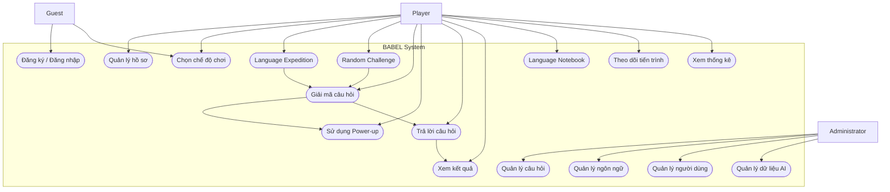
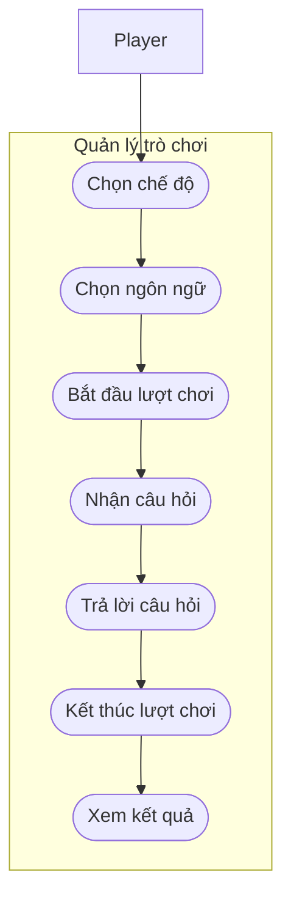
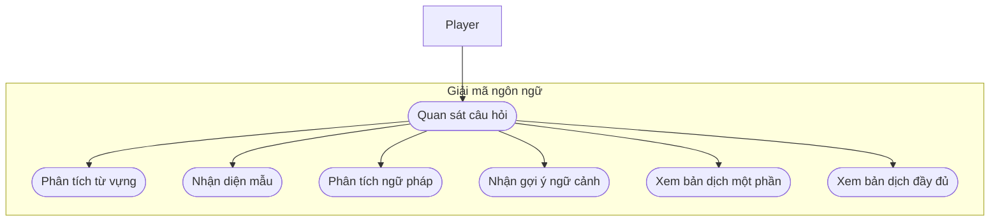
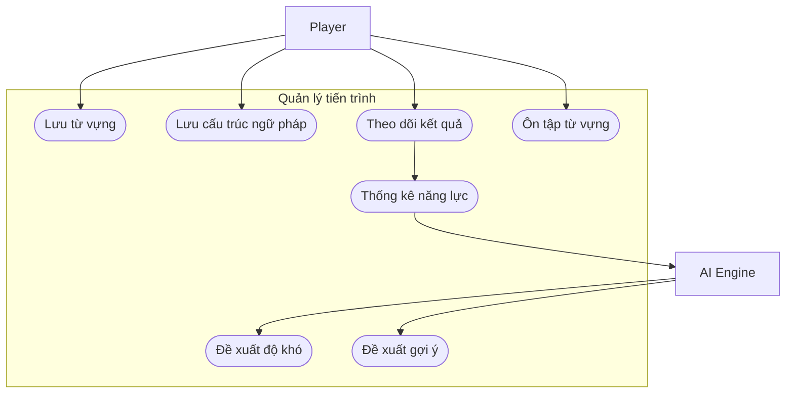
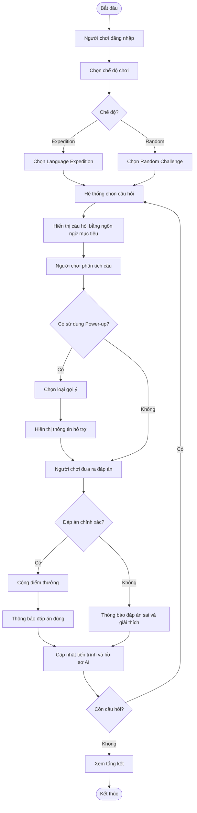
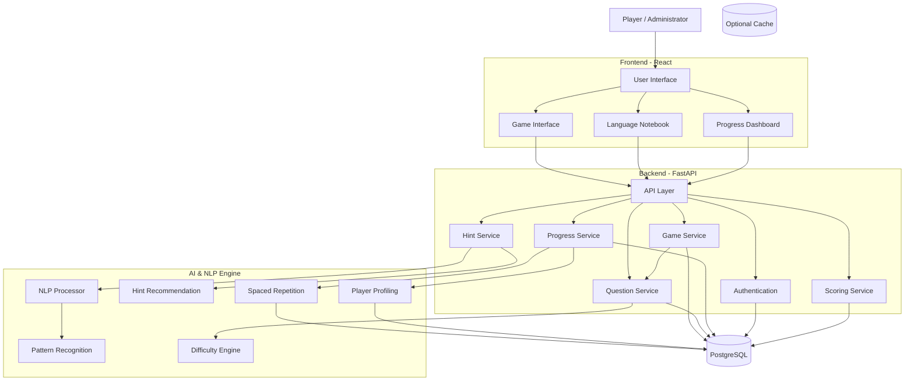
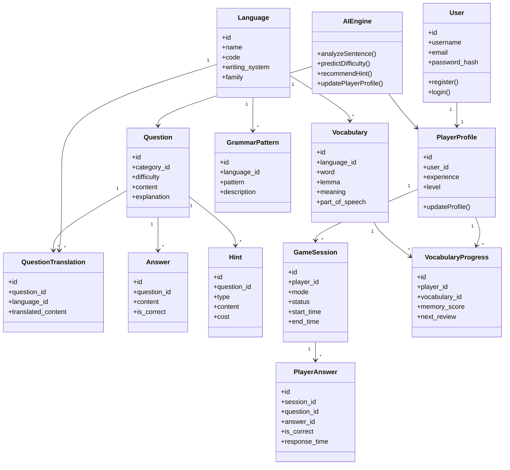

# BABEL – LANGUAGE DECIPHERING & KNOWLEDGE DISCOVERY GAME

# CHƯƠNG 1. GIỚI THIỆU ĐỀ TÀI

## 1.1. Đặt vấn đề

Trong thời đại toàn cầu hóa, ngôn ngữ không chỉ là phương tiện giao tiếp mà còn là cánh cửa dẫn đến kho tàng tri thức, lịch sử và văn hóa của nhân loại. Trên thế giới hiện tồn tại hàng nghìn ngôn ngữ khác nhau, mỗi ngôn ngữ mang trong mình một hệ thống từ vựng, cấu trúc ngữ pháp và đặc trưng văn hóa riêng biệt.

Tuy nhiên, việc tiếp cận và học một ngôn ngữ mới thường đòi hỏi người học phải trải qua quá trình ghi nhớ từ vựng, học ngữ pháp và luyện tập trong thời gian dài. Các phương pháp học truyền thống đôi khi thiếu yếu tố khám phá và chưa tạo được động lực đủ mạnh để người học chủ động tìm hiểu những ngôn ngữ xa lạ.

Bên cạnh đó, các trò chơi kiến thức phổ biến thường tập trung vào khả năng ghi nhớ thông tin và trả lời câu hỏi. Người chơi chủ yếu tiếp nhận câu hỏi bằng ngôn ngữ mà họ đã hiểu, do đó yếu tố ngôn ngữ chưa thực sự trở thành một thử thách trí tuệ độc lập.

Xuất phát từ những vấn đề trên, đề tài **BABEL – Language Deciphering & Knowledge Discovery Game** được đề xuất nhằm kết hợp ba yếu tố: giải mã ngôn ngữ, khám phá tri thức và trò chơi tương tác.

Ý tưởng cốt lõi của BABEL là đặt người chơi trước một câu hỏi được trình bày bằng một ngôn ngữ mà họ có thể chưa từng học. Thay vì cung cấp ngay bản dịch hoàn chỉnh, hệ thống cho phép người chơi quan sát câu, nhận diện từ vựng, phát hiện những mẫu ngôn ngữ lặp lại, suy luận cấu trúc ngữ pháp và sử dụng các công cụ hỗ trợ để từng bước hiểu được nội dung câu hỏi.

Sau khi giải mã câu hỏi, người chơi cần vận dụng kiến thức của mình để đưa ra câu trả lời chính xác. Nội dung câu hỏi không chỉ giới hạn ở những kiến thức phổ thông mà còn mở rộng đến các lĩnh vực chuyên sâu như lịch sử, khoa học, triết học, địa lý, nghệ thuật và văn hóa.

Điểm khác biệt của BABEL nằm ở việc biến quá trình tiếp xúc với ngôn ngữ mới thành một hoạt động khám phá và giải đố. Người chơi không học ngôn ngữ chỉ để ghi nhớ, mà học vì họ muốn hiểu được những điều thú vị đang ẩn sau một câu văn tưởng chừng không thể đọc được.

Ngoài ra, đề tài định hướng ứng dụng trí tuệ nhân tạo không sinh nội dung (Non-generative AI) để phân tích hành vi, nhận diện mẫu ngôn ngữ, đánh giá khả năng ghi nhớ và điều chỉnh độ khó phù hợp với từng người chơi.

Thông qua đó, BABEL hướng tới việc xây dựng một môi trường giải trí mang tính giáo dục, trong đó mỗi câu hỏi vừa là một thử thách kiến thức, vừa là một cơ hội để người chơi phát triển năng lực suy luận ngôn ngữ.

## 1.2. Mục tiêu và phạm vi đề tài

### 1.2.1. Mục tiêu tổng quát

Xây dựng một trò chơi giải đố kết hợp khám phá kiến thức tổng hợp, trong đó người chơi phải giải mã câu hỏi bằng một ngôn ngữ chưa quen thuộc trước khi trả lời nội dung câu hỏi.

Hệ thống hướng tới việc tạo ra trải nghiệm học tập thông qua khám phá, giúp người chơi dần hình thành khả năng nhận diện từ vựng, hiểu cấu trúc ngữ pháp và suy luận ý nghĩa của những câu văn mới.

### 1.2.2. Mục tiêu cụ thể

- Xây dựng hệ thống tài khoản và quản lý thông tin người chơi.
- Xây dựng ngân hàng câu hỏi kiến thức thuộc nhiều lĩnh vực.
- Hỗ trợ trình bày câu hỏi bằng nhiều ngôn ngữ khác nhau.
- Phát triển cơ chế giải mã câu hỏi thông qua các công cụ hỗ trợ.
- Xây dựng hệ thống gợi ý nhiều cấp độ.
- Phát triển chế độ Language Expedition để người chơi tập trung khám phá từng ngôn ngữ.
- Phát triển chế độ Random Challenge để tạo ra những thử thách bất ngờ.
- Xây dựng Language Notebook để lưu trữ từ vựng và cấu trúc ngữ pháp đã khám phá.
- Theo dõi lịch sử chơi, kết quả và tiến trình phát triển của người chơi.
- Ứng dụng các thuật toán AI không sinh nội dung để phân tích khả năng ngôn ngữ và điều chỉnh trải nghiệm.
- Xây dựng hệ thống đánh giá, tính điểm và mở khóa thành tựu.

### 1.2.3. Phạm vi đề tài

**Phạm vi chức năng**

Phiên bản MVP tập trung vào những chức năng sau:

| Nhóm chức năng | Nội dung |
|---|---|
| Quản lý người dùng | Đăng ký, đăng nhập, cập nhật hồ sơ |
| Quản lý trò chơi | Bắt đầu, tạm dừng và kết thúc lượt chơi |
| Question Bank | Lưu trữ và phân loại câu hỏi kiến thức |
| Language System | Quản lý ngôn ngữ, từ vựng và cấu trúc |
| Hint System | Cung cấp các loại gợi ý giải mã |
| Language Expedition | Chơi theo từng ngôn ngữ và cấp độ |
| Random Challenge | Nhận câu hỏi ngẫu nhiên từ các ngôn ngữ đã mở khóa |
| Language Notebook | Lưu trữ từ vựng và kiến thức ngôn ngữ |
| Progress Tracking | Theo dõi tiến trình và thống kê |
| AI Engine | Phân tích năng lực và điều chỉnh độ khó |
| Achievement | Thành tựu và hệ thống cấp bậc |

**Phạm vi ngôn ngữ**

Trong giai đoạn đầu, hệ thống tập trung vào một số ngôn ngữ có nguồn dữ liệu tương đối tốt:

- English.
- Spanish.
- French.
- German.
- Finnish.

Kiến trúc được thiết kế để có thể bổ sung thêm các ngôn ngữ khác trong tương lai.

**Phạm vi kiến thức**

Ngân hàng câu hỏi được chia thành các nhóm:

1. History – Lịch sử.
2. Science – Khoa học.
3. Geography – Địa lý.
4. Philosophy – Triết học.
5. Linguistics – Ngôn ngữ học.
6. Arts & Culture – Nghệ thuật và văn hóa.

**Những nội dung chưa nằm trong phạm vi MVP**

- Thi đấu trực tuyến thời gian thực.
- Hệ thống xếp hạng toàn cầu.
- Chat và tương tác xã hội.
- Hỗ trợ toàn bộ ngôn ngữ trên thế giới.
- Nhận diện giọng nói và hội thoại bằng giọng nói.
- Tạo câu hỏi và bản dịch tự động bằng Generative AI.
- Hệ thống nội dung do người dùng tự tạo và chia sẻ.

### 1.2.4. Đối tượng sử dụng

- Người yêu thích ngôn ngữ và khám phá ngôn ngữ mới.
- Người có kiến thức tổng hợp và yêu thích các câu đố trí tuệ.
- Sinh viên và người học ngoại ngữ.
- Những người muốn rèn luyện khả năng suy luận, nhận diện mẫu và ghi nhớ.

## 1.3. Định hướng giải pháp

BABEL được định hướng phát triển thành một trò chơi có cơ chế giải mã ngôn ngữ làm trung tâm.

### 1.3.1. Gameplay cốt lõi

Một lượt chơi cơ bản gồm các bước:

1. Hệ thống lựa chọn một câu hỏi từ ngân hàng dữ liệu.
2. Câu hỏi được hiển thị bằng một ngôn ngữ được lựa chọn theo chế độ chơi.
3. Người chơi quan sát câu hỏi và tự phân tích những thành phần chưa hiểu.
4. Người chơi có thể sử dụng các Power-up để nhận thông tin hỗ trợ.
5. Người chơi suy luận nội dung câu hỏi.
6. Người chơi lựa chọn hoặc nhập câu trả lời.
7. Hệ thống kiểm tra kết quả và tính điểm.
8. Hệ thống cung cấp lời giải, bản dịch và kiến thức bổ sung.
9. Tiến trình ngôn ngữ được cập nhật.
10. Người chơi chuyển sang câu hỏi tiếp theo.

### 1.3.2. Hệ thống Power-up

Power-up không chỉ có nhiệm vụ tiết lộ bản dịch mà còn giúp người chơi hiểu cách một ngôn ngữ vận hành.

| Power-up | Chức năng | Giá trị học tập |
|---|---|---|
| Lexicon | Tiết lộ nghĩa của một từ | Học từ vựng |
| Pattern Recognition | Đánh dấu từ hoặc gốc từ đã gặp | Nhận diện mẫu |
| Grammar Decoder | Phân tích vai trò và quan hệ giữa các từ | Hiểu ngữ pháp |
| Contextual Clue | Cung cấp thông tin ngữ cảnh | Suy luận ý nghĩa |
| Partial Translation | Tiết lộ một phần bản dịch | Kết nối các thành phần |
| Full Translation | Hiển thị bản dịch hoàn chỉnh | Hiểu chính xác câu hỏi |

Các Power-up có thể tiêu tốn tài nguyên trong trò chơi hoặc làm giảm điểm thưởng của lượt chơi.

### 1.3.3. Các chế độ chơi

**A. Language Expedition**

Người chơi lựa chọn một ngôn ngữ và tham gia chuỗi câu hỏi liên tiếp.

Một Expedition có thể gồm 5–10 câu hỏi, được sắp xếp theo độ khó tăng dần.

Các giai đoạn:

- Discovery: Làm quen với từ vựng và mẫu câu cơ bản.
- Recognition: Nhận diện những từ đã xuất hiện.
- Comprehension: Hiểu cấu trúc và quan hệ giữa các từ.
- Independence: Giải mã câu hỏi với ít sự trợ giúp.
- Mastery: Vận dụng kiến thức đã tích lũy để giải quyết câu hỏi mới.

**B. Random Challenge**

Người chơi nhận các câu hỏi được lựa chọn ngẫu nhiên từ những ngôn ngữ đã mở khóa.

Chế độ này khuyến khích khả năng thích nghi với nhiều ngôn ngữ và tạo ra trải nghiệm bất ngờ.

**C. Daily Challenge**

Một thử thách chung được cung cấp mỗi ngày. Trong MVP, đây là chế độ thử thách cá nhân; tính năng đồng bộ kết quả và thi đấu toàn cầu có thể phát triển sau.

### 1.3.4. Định hướng ứng dụng AI

BABEL sử dụng AI để hỗ trợ quá trình học tập và giải mã, không thay thế người chơi trong việc suy luận.

Các thuật toán được đề xuất:

- Natural Language Processing để phân tích dữ liệu ngôn ngữ.
- Pattern Matching để nhận diện từ và cấu trúc đã xuất hiện.
- Machine Learning để ước lượng độ khó và khả năng của người chơi.
- Recommendation Algorithm để lựa chọn gợi ý.
- Spaced Repetition để lên lịch ôn tập.
- Knowledge Profiling để xây dựng hồ sơ năng lực.

Nguồn dữ liệu ngôn ngữ và bản dịch được chuẩn bị, kiểm tra và lưu trữ trước. AI chủ yếu thực hiện phân tích trên nguồn dữ liệu đã có.

## 1.4. Bố cục đồ án

Đồ án được chia thành sáu chương:

- **Chương 1 – Giới thiệu đề tài:** Trình bày lý do lựa chọn, mục tiêu, phạm vi và định hướng giải pháp.
- **Chương 2 – Khảo sát và phân tích yêu cầu:** Khảo sát các hệ thống liên quan, phân tích chức năng, xây dựng biểu đồ Use Case và đặc tả nghiệp vụ.
- **Chương 3 – Nền tảng lý thuyết và công nghệ sử dụng:** Trình bày các kiến thức về NLP, Machine Learning, thuật toán trò chơi và công nghệ phát triển.
- **Chương 4 – Phân tích thiết kế, triển khai và đánh giá hệ thống:** Trình bày kiến trúc, thiết kế giao diện, lớp, cơ sở dữ liệu, quá trình triển khai và kiểm thử.
- **Chương 5 – Các giải pháp và đóng góp nổi bật:** Phân tích những điểm mới, cơ chế AI và các giải pháp kỹ thuật của BABEL.
- **Chương 6 – Kết luận và hướng phát triển:** Tổng kết kết quả và đề xuất các tính năng mở rộng.

---

# CHƯƠNG 2. KHẢO SÁT VÀ PHÂN TÍCH YÊU CẦU

## 2.1. Khảo sát hiện trạng

### 2.1.1. Khảo sát các hệ thống liên quan

BABEL tham khảo ý tưởng và phương pháp tiếp cận từ một số sản phẩm thuộc các lĩnh vực khác nhau.

**Duolingo**

Duolingo tập trung vào việc học ngôn ngữ thông qua bài học ngắn, luyện tập từ vựng, ngữ pháp và hệ thống duy trì thói quen.

Điểm có thể kế thừa:

- Chia nhỏ nội dung học.
- Theo dõi tiến trình.
- Ôn tập kiến thức đã học.
- Tạo động lực bằng thành tựu.

Điểm khác biệt của BABEL: Người chơi không được cung cấp bài học trực tiếp theo trình tự mà phải chủ động khám phá ý nghĩa của câu thông qua quá trình giải đố.

**GeoGuessr**

GeoGuessr khuyến khích người chơi quan sát dữ liệu không đầy đủ, nhận diện dấu hiệu và suy luận để tìm ra vị trí địa lý.

Điểm có thể kế thừa:

- Quan sát.
- Suy luận.
- Đưa ra giả thuyết.
- Ra quyết định dựa trên thông tin hạn chế.

BABEL áp dụng tư duy này vào việc giải mã ngôn ngữ.

**Quiz và Trivia Games**

Các trò chơi trắc nghiệm cung cấp câu hỏi thuộc nhiều lĩnh vực và đánh giá khả năng kiến thức của người chơi.

Điểm có thể kế thừa:

- Ngân hàng câu hỏi.
- Phân loại chủ đề.
- Tính điểm.
- Độ khó.
- Giải thích đáp án.

Điểm khác biệt của BABEL là người chơi phải giải mã ngôn ngữ trước khi trả lời câu hỏi.

### 2.1.2. Nhận xét và định hướng

Qua khảo sát, có thể nhận thấy mỗi nhóm sản phẩm giải quyết một phần nhu cầu:

| Tiêu chí | Language Learning | Trivia Game | BABEL |
|---|---|---|---|
| Học từ vựng | Có | Không phải trọng tâm | Có |
| Khám phá ngữ pháp | Có | Không | Có |
| Giải mã ngôn ngữ | Hạn chế | Không | Trọng tâm |
| Kiến thức tổng hợp | Hạn chế | Có | Có |
| Suy luận từ dữ liệu | Có nhưng tùy bài học | Có | Trọng tâm |
| AI thích nghi | Có ở một số sản phẩm | Tùy hệ thống | Định hướng cốt lõi |

BABEL không nhằm thay thế các ứng dụng học ngôn ngữ hoặc trò chơi kiến thức hiện có. Đề tài hướng đến việc kết hợp các ưu điểm của chúng thành một trải nghiệm mới.

## 2.2. Tổng quan chức năng

### 2.2.1. Biểu đồ Use Case tổng quát

**Tác nhân chính:**

- Guest: Người chưa đăng nhập.
- Player: Người chơi đã đăng nhập.
- Administrator: Người quản trị hệ thống.

**Các nhóm chức năng:**

- Quản lý tài khoản.
- Quản lý trò chơi.
- Giải mã ngôn ngữ.
- Quản lý gợi ý.
- Quản lý tiến trình.
- Quản lý dữ liệu.
- Quản lý AI.
- Thống kê và thành tựu.

Biểu đồ Use Case tổng quát:



### 2.2.2. Biểu đồ Use Case phân rã XYZ

Để làm rõ nghiệp vụ, hệ thống được chia thành ba nhóm chức năng chính.

**XYZ được xác định như sau:**

- X: Quản lý và tham gia trò chơi.
- Y: Giải mã ngôn ngữ và sử dụng gợi ý.
- Z: Quản lý tiến trình và AI.

**X – Quản lý trò chơi**



**Y – Giải mã ngôn ngữ**



**Z – Tiến trình và AI**



### 2.2.3. Quy trình nghiệp vụ

**Quy trình nghiệp vụ tổng thể**



**Quy trình xử lý một câu hỏi**

1. Hệ thống nhận diện chế độ chơi hiện tại.
2. AI Engine cung cấp mức độ khó phù hợp.
3. Question Selection Service lựa chọn câu hỏi tương ứng.
4. Language Service lấy nội dung câu hỏi và dữ liệu ngôn ngữ.
5. Giao diện hiển thị câu hỏi.
6. Người chơi sử dụng các công cụ giải mã.
7. Hint Service kiểm tra tài nguyên và trả về gợi ý.
8. Người chơi gửi câu trả lời.
9. Answer Evaluation Service kiểm tra đáp án.
10. Scoring Service tính điểm.
11. Player Analytics cập nhật dữ liệu năng lực.
12. Spaced Repetition Service cập nhật lịch ôn tập.

## 2.3. Đặc tả chức năng

### 2.3.1. Đặc tả Use Case A – Tham gia một lượt chơi

| Thuộc tính | Nội dung |
|---|---|
| Use Case ID | UC-01 |
| Tên | Tham gia một lượt chơi |
| Tác nhân | Player |
| Mục tiêu | Bắt đầu và hoàn thành một lượt chơi |
| Tiền điều kiện | Người chơi đã đăng nhập |
| Hậu điều kiện | Kết quả được lưu vào lịch sử |

**Luồng sự kiện chính:**

1. Người chơi truy cập màn hình Game.
2. Hệ thống hiển thị các chế độ chơi.
3. Người chơi chọn Language Expedition hoặc Random Challenge.
4. Người chơi lựa chọn ngôn ngữ nếu chế độ cho phép.
5. Hệ thống xác định độ khó.
6. Hệ thống chọn câu hỏi phù hợp.
7. Người chơi giải mã và trả lời câu hỏi.
8. Hệ thống kiểm tra đáp án.
9. Hệ thống tính điểm và cập nhật tiến trình.
10. Người chơi tiếp tục hoặc kết thúc lượt chơi.
11. Hệ thống hiển thị kết quả tổng kết.

**Luồng ngoại lệ:**

- Người chơi chưa đăng nhập: hệ thống yêu cầu đăng nhập.
- Không có câu hỏi phù hợp: hệ thống tìm câu hỏi dự phòng.
- Mất kết nối: hệ thống lưu trạng thái gần nhất nếu có thể.
- Hết thời gian: hệ thống tự động kết thúc câu hỏi theo luật chơi.

### 2.3.2. Đặc tả Use Case B – Giải mã câu hỏi bằng Power-up

| Thuộc tính | Nội dung |
|---|---|
| Use Case ID | UC-02 |
| Tên | Giải mã câu hỏi |
| Tác nhân | Player |
| Mục tiêu | Hiểu ý nghĩa câu hỏi bằng ngôn ngữ chưa quen thuộc |
| Tiền điều kiện | Một câu hỏi đang được hiển thị |
| Hậu điều kiện | Thông tin gợi ý được hiển thị và trạng thái sử dụng được ghi nhận |

**Luồng sự kiện chính:**

1. Người chơi quan sát câu hỏi.
2. Người chơi lựa chọn một Power-up.
3. Hệ thống kiểm tra tài nguyên.
4. Hint Recommendation Engine phân tích tình trạng hiện tại.
5. Hệ thống xác định loại gợi ý được yêu cầu.
6. Hint Service truy xuất dữ liệu tương ứng.
7. Hệ thống hiển thị gợi ý.
8. Hệ thống cập nhật số tài nguyên và điểm thưởng.
9. Người chơi tiếp tục suy luận.

**Luồng ngoại lệ:**

- Không đủ tài nguyên: hệ thống thông báo.
- Gợi ý đã được sử dụng: hệ thống không trừ tài nguyên lần nữa.
- Không có dữ liệu gợi ý: hệ thống cung cấp loại gợi ý dự phòng.
- Dữ liệu ngôn ngữ không hợp lệ: câu hỏi bị loại khỏi quá trình lựa chọn và được ghi nhận để kiểm tra.

### 2.3.3. Đặc tả Use Case C – Ôn tập từ vựng thông minh

| Thuộc tính | Nội dung |
|---|---|
| Use Case ID | UC-03 |
| Tên | Ôn tập từ vựng |
| Tác nhân | Player, AI Engine |
| Mục tiêu | Củng cố khả năng ghi nhớ từ vựng |
| Tiền điều kiện | Người chơi có dữ liệu từ vựng đã gặp |
| Hậu điều kiện | Trạng thái ghi nhớ và lịch ôn tập được cập nhật |

**Luồng sự kiện chính:**

1. Người chơi truy cập Language Notebook.
2. Hệ thống hiển thị danh sách từ đã gặp.
3. AI Engine xác định những từ cần ôn tập.
4. Hệ thống hiển thị bài kiểm tra ngắn.
5. Người chơi trả lời.
6. Hệ thống đánh giá mức độ ghi nhớ.
7. Thuật toán Spaced Repetition cập nhật thời gian ôn tập tiếp theo.
8. Hệ thống lưu kết quả.

### 2.3.4. Đặc tả Use Case D – Quản lý ngân hàng câu hỏi

| Thuộc tính | Nội dung |
|---|---|
| Use Case ID | UC-04 |
| Tên | Quản lý câu hỏi |
| Tác nhân | Administrator |
| Mục tiêu | Quản lý dữ liệu câu hỏi và bản dịch |
| Tiền điều kiện | Administrator đã đăng nhập |
| Hậu điều kiện | Dữ liệu được cập nhật |

**Luồng sự kiện chính:**

1. Administrator truy cập trang quản trị.
2. Chọn chức năng quản lý câu hỏi.
3. Hệ thống hiển thị danh sách câu hỏi.
4. Administrator thêm, sửa hoặc xóa câu hỏi.
5. Administrator nhập bản dịch tương ứng.
6. Administrator cập nhật gợi ý và đáp án.
7. Hệ thống kiểm tra tính đầy đủ của dữ liệu.
8. Dữ liệu được lưu trữ.

## 2.4. Yêu cầu phi chức năng

### 2.4.1. Hiệu năng

- Các thao tác thông thường cần phản hồi nhanh.
- Việc tải câu hỏi và gợi ý không được gây gián đoạn trải nghiệm.
- Các phép tính AI cần được tối ưu để không làm chậm lượt chơi.
- Dữ liệu thống kê cần được truy vấn hiệu quả.

### 2.4.2. Bảo mật

- Mật khẩu phải được mã hóa bằng thuật toán băm an toàn.
- Phân quyền giữa Player và Administrator.
- Kiểm tra dữ liệu đầu vào.
- Bảo vệ API khỏi các truy cập trái phép.
- Không lưu trữ thông tin nhạy cảm không cần thiết.

### 2.4.3. Khả năng mở rộng

- Có thể bổ sung ngôn ngữ mới mà không phải thay đổi toàn bộ kiến trúc.
- Có thể bổ sung lĩnh vực kiến thức mới.
- Có thể nâng cấp AI Engine độc lập.
- Có thể bổ sung chế độ chơi và loại Power-up mới.

### 2.4.4. Tính chính xác

- Nội dung câu hỏi cần có đáp án được xác thực.
- Bản dịch cần được kiểm duyệt.
- Dữ liệu ngữ pháp cần có nguồn tham chiếu.
- Mỗi câu hỏi phải có thông tin giải thích sau khi trả lời.

### 2.4.5. Tính dễ sử dụng

- Giao diện trực quan.
- Các Power-up có mô tả rõ ràng.
- Hướng dẫn chơi dễ hiểu.
- Hỗ trợ hiển thị các hệ chữ khác nhau.
- Có khả năng thích nghi với màn hình máy tính và thiết bị di động.

---

# CHƯƠNG 3. NỀN TẢNG LÝ THUYẾT VÀ CÔNG NGHỆ SỬ DỤNG

## 3.1. Tổng quan về xử lý ngôn ngữ tự nhiên (NLP)

Natural Language Processing là lĩnh vực kết hợp giữa khoa học máy tính, trí tuệ nhân tạo và ngôn ngữ học nhằm giúp máy tính xử lý và phân tích ngôn ngữ tự nhiên.

Trong BABEL, NLP được sử dụng để:

- Phân tách câu thành các từ.
- Phân loại từ loại.
- Nhận diện từ vựng.
- Phân tích cấu trúc câu.
- Nhận diện những thành phần ngôn ngữ đã xuất hiện.
- Hỗ trợ xây dựng gợi ý giải mã.

### 3.1.1. Tokenization

Tokenization là quá trình phân tách văn bản thành những đơn vị nhỏ hơn như từ hoặc ký tự.

Ví dụ:

Câu tiếng Anh:

"The planet is known as the Red Planet."

Sau khi Tokenization:

```text
["The", "planet", "is", "known", "as", "the", "Red", "Planet"]
```

Trong BABEL, dữ liệu này được sử dụng để xác định những từ người chơi đã gặp và những từ cần hỗ trợ.

### 3.1.2. Part-of-Speech Tagging

POS Tagging là quá trình xác định vai trò ngữ pháp của từng từ.

Các nhóm phổ biến:

- Noun: Danh từ.
- Verb: Động từ.
- Adjective: Tính từ.
- Adverb: Trạng từ.
- Pronoun: Đại từ.
- Preposition: Giới từ.

Kết quả phân tích có thể được sử dụng bởi Grammar Decoder.

### 3.1.3. Lemmatization

Lemmatization đưa một từ về dạng nguyên mẫu có ý nghĩa tương ứng.

Ví dụ:

```text
running -> run
studies -> study
better -> good
```

Đây là cơ sở để nhận diện những từ có chung dạng nguyên mẫu và hỗ trợ phát hiện mẫu từ vựng.

Lưu ý: Lemmatization cần sử dụng bộ xử lý phù hợp với từng ngôn ngữ; không thể áp dụng một bộ quy tắc chung cho tất cả.

## 3.2. Machine Learning

Machine Learning là phương pháp cho phép hệ thống học các quy luật từ dữ liệu và đưa ra dự đoán mà không cần lập trình thủ công mọi trường hợp.

BABEL sử dụng Machine Learning cho những chức năng:

- Ước lượng độ khó câu hỏi.
- Phân tích năng lực người chơi.
- Dự đoán khả năng trả lời đúng.
- Đề xuất gợi ý.
- Phân nhóm người chơi theo hành vi.

### 3.2.1. Difficulty Prediction

Mỗi câu hỏi được mô tả bằng một tập thuộc tính:

- Số lượng từ.
- Độ dài câu.
- Tần suất xuất hiện của từ.
- Độ phức tạp ngữ pháp.
- Số lượng từ mới.
- Độ khó kiến thức.
- Tỷ lệ trả lời đúng trong lịch sử.

Có thể sử dụng Decision Tree hoặc Random Forest để phân loại độ khó.

Đầu ra:

```text
EASY
MEDIUM
HARD
EXPERT
```

### 3.2.2. Player Skill Profiling

Hệ thống xây dựng hồ sơ năng lực dựa trên:

- Tỷ lệ nhận diện từ không cần gợi ý.
- Tỷ lệ sử dụng Power-up.
- Thời gian giải mã.
- Khả năng nhận diện cấu trúc.
- Khả năng ghi nhớ sau nhiều lượt chơi.
- Tỷ lệ trả lời đúng.

Thay vì chỉ sử dụng một điểm tổng, hệ thống phân chia năng lực thành nhiều nhóm:

```text
Vocabulary Skill
Grammar Recognition
Contextual Reasoning
Knowledge Accuracy
Memory Retention
```

### 3.2.3. Recommendation System

Recommendation System lựa chọn nội dung phù hợp với trạng thái người chơi.

Ví dụ:

Nếu người chơi nhận diện từ vựng tốt nhưng gặp khó khăn với cấu trúc ngữ pháp, hệ thống sẽ ưu tiên những câu hỏi có cấu trúc tương tự để người chơi luyện tập.

## 3.3. Thuật toán Spaced Repetition

Spaced Repetition là phương pháp ôn tập kiến thức theo những khoảng thời gian được điều chỉnh dựa trên khả năng ghi nhớ.

Trong BABEL, mỗi từ vựng có các thuộc tính:

- Số lần gặp.
- Số lần trả lời đúng.
- Số lần cần gợi ý.
- Lần ôn tập gần nhất.
- Thời gian ôn tập tiếp theo.
- Mức độ ghi nhớ.

Một thuật toán ban đầu có thể sử dụng các khoảng thời gian:

```text
Lần 1: Sau 1 ngày
Lần 2: Sau 3 ngày
Lần 3: Sau 7 ngày
Lần 4: Sau 14 ngày
Lần 5: Sau 30 ngày
```

Nếu người chơi trả lời sai, thời gian ôn tập được rút ngắn.

Đây là lịch mặc định minh họa; hệ thống thực tế có thể điều chỉnh dựa trên kết quả ghi nhớ.

## 3.4. Thuật toán xử lý gợi ý

BABEL sử dụng hệ thống gợi ý theo cấp độ.

Có thể xây dựng một cơ chế lựa chọn gợi ý dựa trên:

- Mức độ khó của câu hỏi.
- Những từ người chơi đã biết.
- Những từ chưa nhận diện được.
- Lịch sử sử dụng gợi ý.
- Kết quả các câu hỏi trước.

Ví dụ:

```python
def recommend_hint(player, question):
    if player.unknown_word_count > 0:
        return "LEXICON"

    if player.grammar_accuracy < 0.5:
        return "GRAMMAR_DECODER"

    if player.context_accuracy < 0.5:
        return "CONTEXTUAL_CLUE"

    return "PARTIAL_TRANSLATION"
```

Đây là thuật toán luật cơ bản cho MVP. Sau khi thu thập đủ dữ liệu, có thể nâng cấp thành mô hình dự đoán lựa chọn gợi ý.

## 3.5. Các công nghệ dự kiến sử dụng

| Thành phần | Công nghệ |
|---|---|
| Frontend | React.js |
| Backend | Python FastAPI |
| Database | PostgreSQL |
| ORM | SQLAlchemy |
| NLP | spaCy, NLTK |
| ML | Scikit-learn |
| Data Processing | Pandas, NumPy |
| Authentication | JWT |
| API Documentation | OpenAPI / Swagger |
| Testing | Pytest |
| Version Control | Git / GitHub |
| Deployment | Docker |

Các công nghệ trên là phương án đề xuất cho MVP và có thể điều chỉnh theo yêu cầu triển khai thực tế.

## 3.6. Định hướng kiến trúc AI không sử dụng Generative AI

BABEL không sử dụng mô hình sinh văn bản để tự động tạo câu hỏi hoặc bản dịch trong quá trình chơi.

Thay vào đó, hệ thống áp dụng các phương pháp:

| Thành phần AI | Phương pháp | Kết quả |
|---|---|---|
| Word Recognition | Tokenization, Lemmatization | Nhận diện từ |
| Grammar Decoder | POS Tagging, Dependency Parsing | Phân tích cấu trúc |
| Difficulty Engine | Decision Tree, Random Forest | Dự đoán độ khó |
| Hint Recommendation | Rule-based, Classification | Chọn gợi ý |
| Player Profiling | Feature Engineering, Clustering | Phân tích năng lực |
| Memory System | Spaced Repetition | Lập lịch ôn tập |

Dữ liệu ngôn ngữ được chuẩn bị và kiểm duyệt trước, giúp giảm nguy cơ tạo ra bản dịch sai hoặc thông tin ngôn ngữ thiếu chính xác.

---

# CHƯƠNG 4. PHÂN TÍCH THIẾT KẾ, TRIỂN KHAI VÀ ĐÁNH GIÁ HỆ THỐNG

## 4.1. Thiết kế kiến trúc

### 4.1.1. Lựa chọn kiến trúc phần mềm

BABEL được đề xuất sử dụng kiến trúc phân lớp kết hợp mô hình Modular Monolith.

Lý do lựa chọn:

- Phù hợp với quy mô MVP.
- Dễ phát triển và kiểm thử.
- Các module có trách nhiệm rõ ràng.
- Không cần vận hành nhiều dịch vụ độc lập.
- Có thể tách riêng AI Engine khi hệ thống mở rộng.

Các lớp chính:

1. Presentation Layer.
2. API Layer.
3. Business Logic Layer.
4. AI & NLP Layer.
5. Data Access Layer.
6. Database Layer.

### 4.1.2. Thiết kế tổng quan



### 4.1.3. Thiết kế chi tiết gói

**Package 1: Authentication**

Chức năng:

- Đăng ký.
- Đăng nhập.
- Đăng xuất.
- Quản lý phiên đăng nhập.
- Phân quyền.

**Package 2: Game Management**

Chức năng:

- Tạo phiên chơi.
- Chọn chế độ.
- Điều phối câu hỏi.
- Quản lý trạng thái lượt chơi.
- Kết thúc lượt chơi.

**Package 3: Language Management**

Chức năng:

- Quản lý ngôn ngữ.
- Quản lý từ vựng.
- Quản lý cấu trúc ngữ pháp.
- Quản lý dữ liệu bản dịch.

**Package 4: Question Management**

Chức năng:

- Lưu câu hỏi.
- Phân loại chủ đề.
- Phân loại độ khó.
- Quản lý đáp án.
- Quản lý lời giải.

**Package 5: Hint Management**

Chức năng:

- Quản lý Power-up.
- Truy xuất dữ liệu gợi ý.
- Kiểm tra tài nguyên.
- Tính chi phí sử dụng.
- Ghi nhận lịch sử gợi ý.

**Package 6: AI Engine**

Chức năng:

- Phân tích câu.
- Nhận diện từ.
- Phân tích ngữ pháp.
- Dự đoán độ khó.
- Đề xuất gợi ý.
- Phân tích năng lực người chơi.

**Package 7: Progress Management**

Chức năng:

- Lưu lịch sử chơi.
- Theo dõi tiến trình.
- Quản lý Language Notebook.
- Lập lịch ôn tập.
- Quản lý thành tựu.

## 4.2. Thiết kế chi tiết

### 4.2.1. Thiết kế giao diện

Hệ thống dự kiến có các màn hình chính:

**A. Home Screen**

Hiển thị:

- Logo BABEL.
- Thông tin người chơi.
- Tiến trình tổng thể.
- Nút bắt đầu trò chơi.
- Daily Challenge.
- Language Collection.

**B. Game Mode Screen**

Cho phép lựa chọn:

- Language Expedition.
- Random Challenge.
- Daily Challenge.

**C. Language Selection Screen**

Hiển thị danh sách ngôn ngữ và thông tin:

- Tên ngôn ngữ.
- Hệ chữ.
- Họ ngôn ngữ.
- Số câu hỏi đã hoàn thành.
- Cấp độ hiện tại.

**D. Game Screen**

Đây là giao diện quan trọng nhất.

Các thành phần:

- Nội dung câu hỏi.
- Ngôn ngữ hiện tại.
- Đồng hồ đếm thời gian.
- Các phương án trả lời.
- Khu vực Power-up.
- Điểm số.
- Tiến trình Expedition.

**E. Language Notebook**

Hiển thị:

- Danh sách từ vựng.
- Nghĩa của từ.
- Ví dụ.
- Số lần đã gặp.
- Mức độ ghi nhớ.
- Lịch ôn tập.

**F. Progress Dashboard**

Hiển thị:

- Tổng số câu hỏi đã giải.
- Tỷ lệ trả lời đúng.
- Số từ đã nhận diện.
- Số cấu trúc đã học.
- Thời gian giải mã trung bình.
- Năng lực theo từng ngôn ngữ.

**G. Administrator Dashboard**

Cho phép quản trị:

- Câu hỏi.
- Ngôn ngữ.
- Bản dịch.
- Từ vựng.
- Gợi ý.
- Người dùng.
- Dữ liệu thống kê.

### 4.2.2. Thiết kế lớp

Các lớp nghiệp vụ chính:

| Lớp | Trách nhiệm |
|---|---|
| User | Quản lý tài khoản |
| PlayerProfile | Quản lý hồ sơ người chơi |
| Language | Thông tin ngôn ngữ |
| Vocabulary | Quản lý từ vựng |
| GrammarPattern | Quản lý mẫu ngữ pháp |
| Question | Thông tin câu hỏi |
| QuestionTranslation | Bản dịch câu hỏi |
| Answer | Đáp án |
| Hint | Thông tin gợi ý |
| PowerUp | Quản lý công cụ hỗ trợ |
| GameSession | Phiên chơi |
| PlayerAnswer | Câu trả lời của người chơi |
| GameResult | Kết quả lượt chơi |
| PlayerProgress | Tiến trình |
| VocabularyProgress | Tiến trình từ vựng |
| Achievement | Thành tựu |
| AIEngine | Điều phối các chức năng AI |

Biểu đồ lớp tổng quan:



### 4.2.3. Thiết kế cơ sở dữ liệu

Cơ sở dữ liệu PostgreSQL được thiết kế theo hướng quan hệ.

**Bảng users**

| Trường | Kiểu dữ liệu | Mô tả |
|---|---|---|
| id | UUID | Khóa chính |
| username | VARCHAR | Tên đăng nhập |
| email | VARCHAR | Email |
| password_hash | VARCHAR | Mật khẩu đã băm |
| role | VARCHAR | Vai trò |
| created_at | TIMESTAMP | Ngày tạo |

**Bảng languages**

| Trường | Kiểu dữ liệu | Mô tả |
|---|---|---|
| id | UUID | Khóa chính |
| name | VARCHAR | Tên ngôn ngữ |
| code | VARCHAR | Mã ngôn ngữ |
| family | VARCHAR | Họ ngôn ngữ |
| writing_system | VARCHAR | Hệ chữ |

**Bảng questions**

| Trường | Kiểu dữ liệu | Mô tả |
|---|---|---|
| id | UUID | Khóa chính |
| category_id | UUID | Chủ đề |
| difficulty | VARCHAR | Độ khó |
| content | TEXT | Nội dung chuẩn |
| explanation | TEXT | Giải thích đáp án |
| correct_answer_id | UUID | Đáp án đúng |

**Bảng question_translations**

| Trường | Kiểu dữ liệu | Mô tả |
|---|---|---|
| id | UUID | Khóa chính |
| question_id | UUID | Câu hỏi |
| language_id | UUID | Ngôn ngữ |
| translated_content | TEXT | Nội dung bản dịch |
| verified | BOOLEAN | Trạng thái xác thực |
| source | TEXT | Nguồn tham chiếu |

**Bảng vocabulary**

| Trường | Kiểu dữ liệu | Mô tả |
|---|---|---|
| id | UUID | Khóa chính |
| language_id | UUID | Ngôn ngữ |
| word | VARCHAR | Từ |
| lemma | VARCHAR | Dạng nguyên mẫu |
| meaning | TEXT | Nghĩa |
| part_of_speech | VARCHAR | Từ loại |
| example | TEXT | Ví dụ |

**Bảng grammar_patterns**

| Trường | Kiểu dữ liệu | Mô tả |
|---|---|---|
| id | UUID | Khóa chính |
| language_id | UUID | Ngôn ngữ |
| pattern | TEXT | Mẫu ngữ pháp |
| description | TEXT | Giải thích |
| example | TEXT | Ví dụ |

**Bảng answers**

| Trường | Kiểu dữ liệu | Mô tả |
|---|---|---|
| id | UUID | Khóa chính |
| question_id | UUID | Câu hỏi |
| content | TEXT | Nội dung đáp án |
| is_correct | BOOLEAN | Đáp án chính xác |

**Bảng hints**

| Trường | Kiểu dữ liệu | Mô tả |
|---|---|---|
| id | UUID | Khóa chính |
| question_id | UUID | Câu hỏi |
| type | VARCHAR | Loại gợi ý |
| content | TEXT | Nội dung |
| cost | INTEGER | Chi phí |

**Bảng game_sessions**

| Trường | Kiểu dữ liệu | Mô tả |
|---|---|---|
| id | UUID | Khóa chính |
| player_id | UUID | Người chơi |
| mode | VARCHAR | Chế độ chơi |
| language_id | UUID | Ngôn ngữ |
| status | VARCHAR | Trạng thái |
| score | INTEGER | Điểm |
| started_at | TIMESTAMP | Thời gian bắt đầu |
| ended_at | TIMESTAMP | Thời gian kết thúc |

**Bảng player_answers**

| Trường | Kiểu dữ liệu | Mô tả |
|---|---|---|
| id | UUID | Khóa chính |
| session_id | UUID | Phiên chơi |
| question_id | UUID | Câu hỏi |
| answer_id | UUID | Đáp án |
| is_correct | BOOLEAN | Kết quả |
| response_time | INTEGER | Thời gian trả lời |
| hints_used | INTEGER | Số gợi ý |

**Bảng vocabulary_progress**

| Trường | Kiểu dữ liệu | Mô tả |
|---|---|---|
| id | UUID | Khóa chính |
| player_id | UUID | Người chơi |
| vocabulary_id | UUID | Từ vựng |
| encounter_count | INTEGER | Số lần gặp |
| correct_count | INTEGER | Số lần nhận diện đúng |
| memory_score | FLOAT | Điểm ghi nhớ |
| next_review | TIMESTAMP | Lịch ôn tập |

**Bảng player_language_progress**

| Trường | Kiểu dữ liệu | Mô tả |
|---|---|---|
| id | UUID | Khóa chính |
| player_id | UUID | Người chơi |
| language_id | UUID | Ngôn ngữ |
| vocabulary_score | FLOAT | Năng lực từ vựng |
| grammar_score | FLOAT | Năng lực ngữ pháp |
| comprehension_score | FLOAT | Khả năng hiểu |
| expedition_level | INTEGER | Cấp độ |

**Bảng achievements**

| Trường | Kiểu dữ liệu | Mô tả |
|---|---|---|
| id | UUID | Khóa chính |
| name | VARCHAR | Tên thành tựu |
| description | TEXT | Mô tả |
| requirement | JSONB | Điều kiện |

**Bảng player_achievements**

| Trường | Kiểu dữ liệu | Mô tả |
|---|---|---|
| id | UUID | Khóa chính |
| player_id | UUID | Người chơi |
| achievement_id | UUID | Thành tựu |
| unlocked_at | TIMESTAMP | Ngày mở khóa |

Các bảng có quan hệ khóa ngoại để đảm bảo tính toàn vẹn dữ liệu. Những trường thường xuyên được truy vấn như `player_id`, `question_id`, `language_id` và `next_review` cần được xem xét đánh chỉ mục.

## 4.3. Xây dựng ứng dụng

### 4.3.1. Thư viện và công cụ sử dụng

**Frontend**

- React.js.
- React Router.
- Axios.
- CSS / Tailwind CSS.
- Chart.js hoặc Recharts.

**Backend**

- Python.
- FastAPI.
- Pydantic.
- SQLAlchemy.
- Alembic.
- PostgreSQL.

**AI & NLP**

- spaCy.
- NLTK.
- Scikit-learn.
- NumPy.
- Pandas.

**Công cụ phát triển**

- Visual Studio Code.
- Git.
- GitHub.
- Postman.
- Docker.

### 4.3.2. Kết quả đạt được

Phần này sẽ được hoàn thiện sau khi triển khai thực tế.

Các kết quả dự kiến:

- Xây dựng ứng dụng game có khả năng tạo và quản lý lượt chơi.
- Xây dựng ngân hàng câu hỏi đa ngôn ngữ.
- Xây dựng các công cụ giải mã.
- Xây dựng Language Expedition và Random Challenge.
- Xây dựng Language Notebook.
- Lưu trữ và thống kê tiến trình.
- Tích hợp hệ thống phân tích ngôn ngữ.
- Tích hợp cơ chế điều chỉnh độ khó và đề xuất gợi ý.
- Xây dựng giao diện quản trị dữ liệu.

### 4.3.3. Minh họa các chức năng chính

**Chức năng 1: Bắt đầu trò chơi**

Mô tả: Người chơi lựa chọn chế độ chơi và bắt đầu một thử thách mới.

Ảnh minh họa: `[Bổ sung ảnh giao diện Home và Game Mode]`

**Chức năng 2: Giải mã câu hỏi**

Ví dụ:

```text
Mikä planeetta tunnetaan punaisena planeettana?
```

Hệ thống hiển thị câu hỏi bằng tiếng Phần Lan.

Người chơi chưa biết ngôn ngữ có thể sử dụng:

- Lexicon.
- Pattern Recognition.
- Grammar Decoder.
- Contextual Clue.
- Partial Translation.
- Full Translation.

Đáp án: Mars.

Ảnh minh họa: `[Bổ sung ảnh Game Screen]`

**Chức năng 3: Sử dụng Power-up**

Mô tả: Người chơi lựa chọn loại gợi ý phù hợp để hỗ trợ quá trình suy luận.

Ảnh minh họa: `[Bổ sung ảnh Hint System]`

**Chức năng 4: Language Notebook**

Mô tả: Hệ thống lưu trữ những từ vựng đã xuất hiện và theo dõi khả năng ghi nhớ.

Ảnh minh họa: `[Bổ sung ảnh Language Notebook]`

**Chức năng 5: AI Progress Dashboard**

Mô tả: Hiển thị sự phát triển năng lực theo từng ngôn ngữ.

Ảnh minh họa: `[Bổ sung ảnh Progress Dashboard]`

**Chức năng 6: Administrator Dashboard**

Mô tả: Quản trị câu hỏi, bản dịch và dữ liệu ngôn ngữ.

Ảnh minh họa: `[Bổ sung ảnh Admin Dashboard]`

## 4.4. Kiểm thử

### 4.4.1. Kiểm thử chức năng

| Test ID | Chức năng | Trường hợp kiểm thử | Kết quả mong đợi |
|---|---|---|---|
| TC01 | Đăng ký | Dữ liệu hợp lệ | Tạo tài khoản |
| TC02 | Đăng ký | Email đã tồn tại | Thông báo lỗi |
| TC03 | Đăng nhập | Thông tin đúng | Đăng nhập thành công |
| TC04 | Đăng nhập | Mật khẩu sai | Từ chối đăng nhập |
| TC05 | Game | Bắt đầu Expedition | Tạo phiên chơi |
| TC06 | Game | Bắt đầu Random Challenge | Nhận câu hỏi ngẫu nhiên |
| TC07 | Hint | Sử dụng Lexicon | Hiển thị nghĩa từ |
| TC08 | Hint | Không đủ tài nguyên | Từ chối sử dụng |
| TC09 | Answer | Đáp án đúng | Cộng điểm |
| TC10 | Answer | Đáp án sai | Hiển thị lời giải |
| TC11 | Notebook | Lưu từ vựng | Cập nhật dữ liệu |
| TC12 | Progress | Hoàn thành lượt chơi | Cập nhật tiến trình |
| TC13 | AI | Phân tích độ khó | Trả về mức độ |
| TC14 | AI | Đề xuất gợi ý | Trả về gợi ý phù hợp |
| TC15 | Admin | Thêm câu hỏi | Lưu dữ liệu |

### 4.4.2. Kiểm thử AI

Các thành phần AI cần được đánh giá độc lập.

| Thành phần | Chỉ số đánh giá |
|---|---|
| Difficulty Prediction | Accuracy, Precision, Recall, F1-score |
| Hint Recommendation | Tỷ lệ gợi ý hữu ích |
| Vocabulary Recognition | Precision, Recall |
| Player Profiling | Mức độ phù hợp với kết quả thực tế |
| Retention Prediction | Khả năng dự đoán ghi nhớ |

Dữ liệu kiểm thử cần được chia thành tập huấn luyện và tập đánh giá nếu sử dụng mô hình Machine Learning có giám sát.

Đối với những ngôn ngữ không có bộ NLP hỗ trợ tốt, hệ thống cần sử dụng dữ liệu đã chú giải thủ công hoặc giới hạn tính năng phân tích tương ứng.

### 4.4.3. Kiểm thử hiệu năng

- Thời gian phản hồi API.
- Thời gian tải câu hỏi.
- Thời gian xử lý gợi ý.
- Khả năng xử lý nhiều yêu cầu.
- Hiệu năng truy vấn cơ sở dữ liệu.

Các ngưỡng hiệu năng cụ thể sẽ được xác định khi triển khai.

## 4.5. Triển khai

### 4.5.1. Môi trường triển khai

Dự kiến triển khai theo mô hình:

- Frontend: Web application.
- Backend: FastAPI.
- Database: PostgreSQL.
- AI Engine: Các module Python.
- Deployment: Docker.

### 4.5.2. Quy trình triển khai

1. Cài đặt môi trường.
2. Cấu hình cơ sở dữ liệu.
3. Chạy migration.
4. Khởi động Backend.
5. Khởi động Frontend.
6. Kiểm tra kết nối API.
7. Kiểm tra các chức năng chính.
8. Kiểm tra dữ liệu và quyền truy cập.

### 4.5.3. Khả năng mở rộng

Trong tương lai, hệ thống có thể triển khai AI Engine thành một dịch vụ độc lập để xử lý những tác vụ phân tích ngôn ngữ có chi phí tính toán cao.

---

# CHƯƠNG 5. CÁC GIẢI PHÁP VÀ ĐÓNG GÓP NỔI BẬT

## 5.1. Kết hợp giải mã ngôn ngữ và khám phá tri thức

Đóng góp quan trọng nhất của BABEL là biến ngôn ngữ trở thành một thử thách trung tâm của trò chơi.

Trong những trò chơi kiến thức thông thường, ngôn ngữ chỉ đóng vai trò phương tiện truyền tải câu hỏi. Trong BABEL, người chơi phải vượt qua rào cản ngôn ngữ trước khi có thể tiếp cận nội dung tri thức.

Điều này tạo ra hai tầng thử thách:

- Tầng thứ nhất: Hiểu câu hỏi.
- Tầng thứ hai: Trả lời câu hỏi.

Người chơi cần kết hợp khả năng quan sát, phân tích, suy luận và kiến thức tổng hợp.

## 5.2. Hệ thống Language Expedition

Thay vì chuyển đổi ngôn ngữ liên tục sau mỗi câu hỏi, BABEL sử dụng cơ chế Expedition để tạo cơ hội tiếp xúc lặp lại với một ngôn ngữ.

Cơ chế này giúp người chơi:

- Ghi nhớ từ vựng.
- Nhận diện những từ đã gặp.
- Hiểu cấu trúc ngữ pháp.
- Tăng khả năng giải mã độc lập.

Sau khi hoàn thành Expedition, ngôn ngữ đó vẫn có thể xuất hiện trong Random Challenge.

## 5.3. Hệ thống trí nhớ ngôn ngữ cá nhân

BABEL không chỉ lưu trữ những câu hỏi người chơi đã trả lời mà còn theo dõi từng đơn vị kiến thức ngôn ngữ.

Ví dụ:

Người chơi gặp từ `vesi` trong tiếng Phần Lan và được cung cấp nghĩa là nước.

Ở lần gặp tiếp theo, hệ thống kiểm tra liệu người chơi có thể tự nhận diện từ này hay không.

Sau nhiều lần tiếp xúc, nếu người chơi nhận diện chính xác mà không cần hỗ trợ, mức độ ghi nhớ được tăng lên.

Điều này giúp phân biệt giữa việc đã từng nhìn thấy một từ và thực sự có khả năng nhận diện từ đó.

## 5.4. Hệ thống gợi ý thích nghi

Thay vì hiển thị mọi loại gợi ý theo một trình tự cố định, BABEL phân tích trạng thái hiện tại để đề xuất công cụ phù hợp.

Ví dụ:

- Nếu người chơi chưa nhận diện được từ quan trọng, ưu tiên Lexicon.
- Nếu nhận diện từ tốt nhưng không hiểu quan hệ giữa các từ, ưu tiên Grammar Decoder.
- Nếu hiểu cấu trúc nhưng chưa suy luận được ý nghĩa, ưu tiên Contextual Clue.

Hệ thống hướng tới việc hỗ trợ người chơi đúng lúc nhưng vẫn giữ nguyên yếu tố tự khám phá.

## 5.5. AI không sinh nội dung

Một điểm nổi bật của BABEL là định hướng sử dụng các thuật toán AI có thể giải thích được thay vì phụ thuộc vào các mô hình tạo sinh.

Các thành phần bao gồm:

- NLP để phân tích câu.
- Decision Tree để phân loại độ khó.
- Random Forest để dự đoán kết quả.
- Rule-based Recommendation để đề xuất gợi ý.
- Spaced Repetition để quản lý trí nhớ.
- Clustering để phân tích nhóm hành vi.

Những thuật toán này có ưu điểm là:

- Có thể kiểm tra và đánh giá.
- Dễ kiểm soát dữ liệu đầu vào.
- Không tự tạo ra bản dịch không được xác thực.
- Phù hợp với hệ thống có phạm vi dữ liệu xác định.
- Có thể triển khai và đánh giá trong quy mô đồ án.

## 5.6. Language Discovery Collection

Mỗi ngôn ngữ người chơi gặp sẽ được bổ sung vào bộ sưu tập cá nhân.

Thông tin bao gồm:

- Tên ngôn ngữ.
- Họ ngôn ngữ.
- Hệ chữ.
- Số lượng người sử dụng (nếu có nguồn dữ liệu).
- Đặc điểm ngữ pháp.
- Những từ đã khám phá.
- Những Expedition đã hoàn thành.

Đây là cơ chế tạo phần thưởng khám phá bên cạnh điểm số.

## 5.7. Cơ chế tính điểm dựa trên khả năng tự giải mã

Điểm số không chỉ phụ thuộc vào đáp án đúng hay sai mà còn phụ thuộc vào mức độ hỗ trợ người chơi sử dụng.

Ví dụ:

| Trạng thái | Điểm cơ sở |
|---|---:|
| Trả lời đúng không cần gợi ý | 1000 |
| Sử dụng Lexicon | 850 |
| Sử dụng Grammar Decoder | 750 |
| Sử dụng Contextual Clue | 700 |
| Sử dụng Partial Translation | 450 |
| Sử dụng Full Translation | 200 |
| Trả lời sai | 0 |

Các mức điểm trên là thông số đề xuất, cần được cân bằng qua thử nghiệm.

Hệ thống cũng cần tránh phạt quá nặng việc sử dụng gợi ý trong giai đoạn đầu, vì mục tiêu quan trọng là khuyến khích khám phá và học tập.

---

# CHƯƠNG 6. KẾT LUẬN VÀ HƯỚNG PHÁT TRIỂN

## 6.1. Kết luận

Đề tài BABEL – Language Deciphering & Knowledge Discovery Game hướng tới việc xây dựng một trò chơi kết hợp giữa giải mã ngôn ngữ và khám phá tri thức.

Khác với những trò chơi trắc nghiệm thông thường, BABEL yêu cầu người chơi phải chủ động phân tích một câu hỏi được trình bày bằng ngôn ngữ chưa quen thuộc trước khi đưa ra câu trả lời.

Thông qua các cơ chế Power-up, Language Expedition, Random Challenge và Language Notebook, hệ thống tạo ra một quá trình tiếp xúc, nhận diện và ghi nhớ ngôn ngữ thông qua trải nghiệm chơi game.

Bên cạnh các chức năng trò chơi cơ bản, đề tài còn định hướng ứng dụng các thuật toán trí tuệ nhân tạo không sinh nội dung nhằm phân tích ngôn ngữ, dự đoán độ khó, đề xuất gợi ý và theo dõi năng lực người chơi.

Những định hướng này góp phần tạo nên một hệ thống vừa có giá trị giải trí, vừa có tiềm năng ứng dụng trong giáo dục và hỗ trợ học ngoại ngữ.

Kết quả triển khai thực tế sẽ được đánh giá dựa trên mức độ hoàn thiện của các chức năng, độ chính xác của dữ liệu ngôn ngữ, hiệu quả của thuật toán và phản hồi từ người dùng thử nghiệm.

## 6.2. Hướng phát triển

### 6.2.1. Mở rộng ngôn ngữ

- Bổ sung các ngôn ngữ ít phổ biến.
- Hỗ trợ các hệ chữ khác nhau.
- Bổ sung ngôn ngữ cổ.
- Hỗ trợ các ngôn ngữ có cấu trúc ngữ pháp phức tạp.

### 6.2.2. Phát triển AI

- Nâng cấp mô hình dự đoán độ khó.
- Cá nhân hóa quá trình học.
- Cải thiện khả năng nhận diện cấu trúc ngôn ngữ.
- Dự đoán khả năng ghi nhớ.
- Phân tích những lỗi suy luận phổ biến.

### 6.2.3. Phát triển gameplay

- Survival Mode.
- Timed Challenge.
- Impossible Round.
- Multiplayer.
- Competitive Ranking.

### 6.2.4. Phát triển dữ liệu kiến thức

- Mở rộng câu hỏi chuyên sâu.
- Bổ sung những chủ đề liên ngành.
- Xây dựng câu hỏi liên quan đến lịch sử và văn hóa của từng ngôn ngữ.
- Xây dựng các chuỗi câu hỏi theo chủ đề.

### 6.2.5. Phát triển tính năng âm thanh

- Phát âm câu hỏi.
- Nhận diện giọng nói.
- Phân tích phát âm.
- Nhận diện từ thông qua âm thanh.

### 6.2.6. Phát triển cộng đồng

- Bảng xếp hạng.
- Chia sẻ thành tích.
- Thử thách bạn bè.
- Tạo và đóng góp ngân hàng câu hỏi có kiểm duyệt.

---

# TÀI LIỆU THAM KHẢO

Các tài liệu tham khảo dự kiến:

[1] Daniel Jurafsky and James H. Martin, *Speech and Language Processing*, 3rd Edition Draft.

[2] Christopher D. Manning, Prabhakar Raghavan, and Hinrich Schütze, *Introduction to Information Retrieval*, Cambridge University Press, 2008.

[3] Stuart Russell and Peter Norvig, *Artificial Intelligence: A Modern Approach*, 4th Edition, Pearson, 2020.

[4] François Chollet, *Deep Learning with Python*, 2nd Edition, Manning Publications, 2021.

[5] Scikit-learn Documentation, https://scikit-learn.org/stable/

[6] spaCy Documentation, https://spacy.io/usage

[7] FastAPI Documentation, https://fastapi.tiangolo.com/

[8] PostgreSQL Documentation, https://www.postgresql.org/docs/

[9] React Documentation, https://react.dev/

[10] Ebbinghaus, H., *Memory: A Contribution to Experimental Psychology*, 1885.

[11] W3C, *Web Content Accessibility Guidelines (WCAG)*, https://www.w3.org/WAI/standards-guidelines/wcag/

---

# PHỤ LỤC

# PHỤ LỤC A. ĐẶC TẢ USE CASE

## A.1. Danh sách Use Case

| ID | Use Case | Actor |
|---|---|---|
| UC01 | Đăng ký tài khoản | Guest |
| UC02 | Đăng nhập | Guest |
| UC03 | Cập nhật hồ sơ | Player |
| UC04 | Chọn chế độ chơi | Player |
| UC05 | Tham gia Language Expedition | Player |
| UC06 | Tham gia Random Challenge | Player |
| UC07 | Nhận câu hỏi | Player |
| UC08 | Giải mã câu hỏi | Player |
| UC09 | Sử dụng Lexicon | Player |
| UC10 | Sử dụng Pattern Recognition | Player |
| UC11 | Sử dụng Grammar Decoder | Player |
| UC12 | Sử dụng Contextual Clue | Player |
| UC13 | Xem Partial Translation | Player |
| UC14 | Xem Full Translation | Player |
| UC15 | Trả lời câu hỏi | Player |
| UC16 | Xem kết quả | Player |
| UC17 | Xem Language Notebook | Player |
| UC18 | Ôn tập từ vựng | Player |
| UC19 | Xem tiến trình | Player |
| UC20 | Xem thành tựu | Player |
| UC21 | Quản lý câu hỏi | Administrator |
| UC22 | Quản lý ngôn ngữ | Administrator |
| UC23 | Quản lý dữ liệu từ vựng | Administrator |
| UC24 | Quản lý người dùng | Administrator |
| UC25 | Quản lý dữ liệu AI | Administrator |

## A.2. Đặc tả Use Case – Sử dụng Lexicon

**UC ID:** UC09

**Actor:** Player

**Mô tả:** Người chơi yêu cầu hệ thống tiết lộ ý nghĩa của một từ trong câu hỏi.

**Tiền điều kiện:**
- Người chơi đang ở một lượt chơi.
- Câu hỏi đang được hiển thị.
- Từ cần tra cứu có trong dữ liệu từ vựng.

**Hậu điều kiện:**
- Nghĩa của từ được hiển thị.
- Lịch sử sử dụng gợi ý được cập nhật.
- Điểm thưởng được điều chỉnh.

**Luồng chính:**

1. Người chơi chọn một từ trong câu hỏi.
2. Người chơi chọn Lexicon.
3. Hệ thống kiểm tra dữ liệu.
4. Hệ thống kiểm tra tài nguyên.
5. Hệ thống truy xuất nghĩa của từ.
6. Hệ thống hiển thị kết quả.
7. Hệ thống cập nhật điểm.

**Luồng thay thế:**

- Nếu từ không có trong từ điển, hệ thống thông báo không tìm thấy dữ liệu.
- Nếu người chơi không đủ tài nguyên, hệ thống từ chối yêu cầu.

## A.3. Đặc tả Use Case – Grammar Decoder

**UC ID:** UC11

**Actor:** Player

**Mô tả:** Hệ thống cung cấp thông tin về vai trò ngữ pháp và cấu trúc câu.

**Tiền điều kiện:**
- Câu hỏi đang được hiển thị.
- Có dữ liệu phân tích ngữ pháp.

**Luồng chính:**

1. Người chơi chọn Grammar Decoder.
2. Hệ thống truy xuất kết quả phân tích câu.
3. Hệ thống hiển thị từ loại.
4. Hệ thống hiển thị quan hệ giữa các từ.
5. Hệ thống giải thích cấu trúc câu dựa trên dữ liệu đã được kiểm duyệt.
6. Người chơi tiếp tục giải mã.

**Luồng thay thế:**

Nếu bộ phân tích không hỗ trợ ngôn ngữ hiện tại, hệ thống sử dụng dữ liệu ngữ pháp được chú giải sẵn.

## A.4. Đặc tả Use Case – Random Challenge

**UC ID:** UC06

**Actor:** Player

**Mô tả:** Người chơi tham gia thử thách có ngôn ngữ và chủ đề được lựa chọn ngẫu nhiên.

**Tiền điều kiện:**
- Người chơi đã đăng nhập.
- Có ít nhất một ngôn ngữ khả dụng.

**Luồng chính:**

1. Người chơi chọn Random Challenge.
2. Hệ thống lấy danh sách ngôn ngữ được phép sử dụng.
3. Hệ thống lựa chọn ngôn ngữ.
4. Hệ thống xác định độ khó phù hợp.
5. Hệ thống lựa chọn chủ đề.
6. Hệ thống lấy câu hỏi hợp lệ.
7. Câu hỏi được hiển thị.
8. Người chơi giải mã và trả lời.
9. Hệ thống cập nhật kết quả.

**Luồng thay thế:**

Nếu không có câu hỏi phù hợp, hệ thống lựa chọn câu hỏi dự phòng.

## A.5. Đặc tả Use Case – Adaptive Difficulty

**UC ID:** UC26

**Actor:** AI Engine

**Mô tả:** Hệ thống điều chỉnh độ khó dựa trên năng lực của người chơi.

**Dữ liệu đầu vào:**

- Tỷ lệ trả lời đúng.
- Thời gian trả lời.
- Số lượng gợi ý sử dụng.
- Số lượng từ mới.
- Mức độ ghi nhớ.
- Độ khó của những câu hỏi trước.

**Luồng chính:**

1. Người chơi hoàn thành một câu hỏi.
2. Hệ thống ghi nhận dữ liệu.
3. AI Engine trích xuất các đặc trưng.
4. Mô hình dự đoán mức độ phù hợp.
5. Hệ thống xác định độ khó tiếp theo.
6. Question Selection Service lựa chọn câu hỏi.
7. Người chơi nhận câu hỏi mới.

**Hậu điều kiện:**

Mức độ khó được cập nhật theo năng lực hiện tại của người chơi.

---

# PHỤ LỤC B. ĐỊNH NGHĨA CÁC THUẬT NGỮ

| Thuật ngữ | Ý nghĩa |
|---|---|
| Babel | Tên trò chơi |
| Language Expedition | Chế độ khám phá một ngôn ngữ |
| Random Challenge | Chế độ thử thách ngẫu nhiên |
| Power-up | Công cụ hỗ trợ giải mã |
| Lexicon | Hệ thống từ vựng |
| Grammar Decoder | Công cụ phân tích ngữ pháp |
| Pattern Recognition | Nhận diện mẫu |
| Contextual Clue | Gợi ý ngữ cảnh |
| Partial Translation | Bản dịch một phần |
| Full Translation | Bản dịch hoàn chỉnh |
| Language Notebook | Sổ tay ngôn ngữ |
| Adaptive Difficulty | Điều chỉnh độ khó |
| Spaced Repetition | Ôn tập ngắt quãng |
| Player Profiling | Phân tích hồ sơ năng lực |
| Non-generative AI | AI không sinh nội dung |

# PHỤ LỤC C. NGUYÊN TẮC THIẾT KẾ DỮ LIỆU NGÔN NGỮ

1. Mỗi câu hỏi cần có một nội dung chuẩn để đối chiếu.
2. Mỗi bản dịch phải gắn với một ngôn ngữ cụ thể.
3. Bản dịch cần được kiểm tra trước khi đưa vào hệ thống.
4. Các từ vựng phải có thông tin về từ loại và nghĩa.
5. Các cấu trúc ngữ pháp phải có ví dụ và giải thích.
6. Các câu hỏi cần có đáp án và lời giải rõ ràng.
7. Dữ liệu không đủ độ tin cậy không được đưa vào chế độ chơi chính thức.
8. AI không được tự ý thay thế dữ liệu ngôn ngữ đã được xác thực.

---

**KẾT THÚC BẢN THẢO BÁO CÁO**